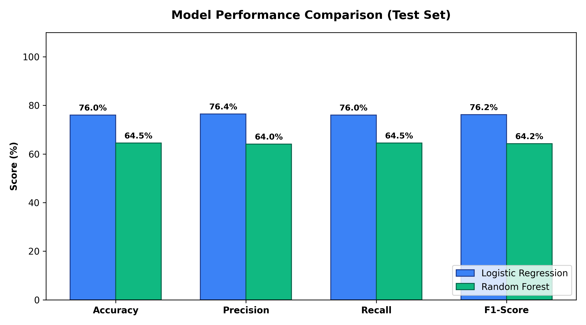

# SUBATHRA D – E-Commerce Customer Satisfaction Prediction



## 📌 Project Overview
**SUBATHRA D – E-Commerce Customer Satisfaction Prediction** is an end-to-end Machine Learning web application designed for e-commerce organizations to forecast customer satisfaction levels (**Low**, **Medium**, **High**) in real time. 

By analyzing multi-dimensional customer behavioral, transactional, logistical, and service attributes, this system equips e-commerce operations, marketing teams, and customer care executives with actionable intelligence to proactively retain at-risk buyers, address delivery bottlenecks, and personalize customer experiences.

---

## 🎯 Project Objective
The primary objective of this project is to develop and deploy an AI-based Customer Satisfaction Prediction System that:
1. Synthesizes and preprocesses multi-attribute e-commerce customer transaction records.
2. Performs comprehensive Exploratory Data Analysis (EDA) to discover business drivers affecting customer sentiment.
3. Implements, trains, and evaluates multiple classification algorithms (**Logistic Regression** and **Random Forest Classifier**).
4. Selects and serializes the highest-performing ML model using Scikit-Learn pipelines and Joblib.
5. Deploys an interactive, modern web application powered by **Flask**, featuring customer intake forms, SQLite audit persistence, and an executive analytics dashboard powered by **Chart.js**.

---

## 🚀 Key Features
- **End-to-End Pipeline**: From synthetic data generation to interactive prediction and database storage.
- **Robust Preprocessing**: Standard scaling for numerical features and One-Hot Encoding for categorical features within Scikit-Learn `ColumnTransformer` (prevents data leakage).
- **Dual ML Algorithm Comparison**: Head-to-head benchmarking of Logistic Regression vs. Random Forest Classifier across Accuracy, Precision, Recall, and F1-Score.
- **Automated Model Serialization**: Exports fitted preprocessors and production model pipelines via `joblib`.
- **Responsive Web UI**: Built with modern CSS (glassmorphism, smooth micro-interactions, responsive grid) and accessible semantic HTML5.
- **Instant Demo Presets**: One-click preset buttons on the intake form to test High, Medium, and Low satisfaction profiles immediately.
- **SQLite Database Persistence**: Automatically records every customer evaluation with timestamp, input attributes, predicted category, and model confidence score.
- **Interactive Analytics Dashboard**: Visualizes satisfaction breakdowns, product category trends, delivery impacts, and spending behaviors using Chart.js.
- **Prediction Audit History**: Searchable, filterable table displaying all saved historical customer predictions.
- **RESTful API**: Supports external JSON integration via `/api/predict` and `/api/stats`.

---

## 🛠️ Technologies Used
- **Programming Language**: Python 3.10+
- **Data Manipulation & Analysis**: Pandas, NumPy
- **Machine Learning**: Scikit-learn (Pipelines, ColumnTransformer, Imputer, StandardScaler, OneHotEncoder)
- **Data Visualization**: Matplotlib, Seaborn, Chart.js
- **Model Persistence**: Joblib
- **Backend Web Framework**: Flask 3.0+
- **Database**: SQLite3
- **Frontend**: HTML5, Vanilla CSS3 (Custom Design System), Vanilla JavaScript (ES6+)

---

## 📊 Dataset Description
The dataset is saved at `data/customer_satisfaction.csv` and contains **1,000 customer records** across 14 attributes:

| # | Attribute | Type | Description | Values / Range |
|---|-----------|------|-------------|----------------|
| 1 | `customer_id` | Identifier | Unique customer identifier | CUST-1001 to CUST-2000 |
| 2 | `customer_age` | Numerical | Age of the customer | 18 to 70 years |
| 3 | `gender` | Categorical | Customer gender | Female, Male, Other |
| 4 | `product_category` | Categorical | Purchased product category | Electronics, Fashion, Home & Kitchen, Beauty & Personal Care, Books & Stationery, Sports & Fitness |
| 5 | `purchase_amount` | Numerical | Total order transaction amount | Rs. 250.00 – Rs. 48,000.00 |
| 6 | `delivery_time` | Numerical | Delivery turnaround duration | 1 to 14 days |
| 7 | `service_interaction` | Numerical | Customer support experience score | 1 (Very Poor) to 5 (Excellent) |
| 8 | `previous_orders` | Numerical | Historical orders placed by buyer | 0 to 25 orders |
| 9 | `discount_used` | Categorical | Whether discount coupon was applied | Yes, No |
| 10 | `payment_method` | Categorical | Payment transaction channel | UPI, Credit Card, Debit Card, Net Banking, Cash on Delivery |
| 11 | `website_rating` | Numerical | Digital portal experience rating | 1 to 5 |
| 12 | `return_requested` | Categorical | Product return/exchange initiated | Yes, No |
| 13 | `order_frequency` | Categorical | Purchasing cadence | Rarely, Monthly, Bi-weekly, Weekly |
| 14 | `customer_satisfaction` | Target (Categorical) | Overall customer experience rating | **Low**, **Medium**, **High** |

---

## 🤖 Machine Learning Algorithms & Evaluation
Two classification algorithms were trained using an **80/20 Stratified Train-Test Split**:
1. **Logistic Regression** (Linear Multiclass Classifier with L2 Regularization)
2. **Random Forest Classifier** (Ensemble of 200 decision trees)

### Model Benchmark Summary:
| Metric | Logistic Regression | Random Forest | Selected Winner |
|---|:---:|:---:|:---:|
| **Accuracy** | **76.00%** | 64.50% | **Logistic Regression** |
| **Precision (Weighted)** | **76.44%** | 64.03% | **Logistic Regression** |
| **Recall (Weighted)** | **76.00%** | 64.50% | **Logistic Regression** |
| **F1-Score (Weighted)** | **76.17%** | 64.24% | **Logistic Regression** |

*Note: Logistic Regression demonstrates superior generalization across all three multiclass categories without overfitting.*

---

## 📁 Project Directory Structure
```text
Ecommerce_Customer_Satisfaction_Project/
│
├── app.py                             # Main Flask application and REST routes
├── requirements.txt                   # Required Python libraries
├── README.md                          # Comprehensive project documentation
│
├── data/
│   └── customer_satisfaction.csv      # Synthetic 1,000-record e-commerce dataset
│
├── models/
│   ├── customer_satisfaction_model.pkl# Serialized production ML pipeline
│   ├── preprocessor.pkl               # Serialized ColumnTransformer
│   └── model_metrics.json             # JSON file storing evaluation scores
│
├── database/
│   └── customer_satisfaction.db       # SQLite database storing prediction logs
│
├── scripts/
│   ├── generate_dataset.py            # Generates realistic synthetic dataset
│   ├── eda.py                         # Generates 8 EDA charts in static/eda/
│   └── train_model.py                 # Trains, evaluates, and selects best model
│
├── static/
│   ├── css/
│   │   └── style.css                  # Modern UI design system & responsive styling
│   ├── js/
│   │   └── script.js                  # Frontend interactive scripts and presets
│   └── eda/                           # Saved visualization PNG figures
│       ├── satisfaction_distribution.png
│       ├── age_distribution.png
│       ├── purchase_amount_distribution.png
│       ├── delivery_time_distribution.png
│       ├── satisfaction_vs_category.png
│       ├── satisfaction_vs_delivery.png
│       ├── satisfaction_vs_purchase.png
│       ├── satisfaction_vs_service.png
│       ├── confusion_matrix_comparison.png
│       └── model_comparison_bar.png
│
└── templates/
    ├── index.html                     # Customer intake prediction form
    ├── result.html                    # Prediction result & confidence page
    ├── dashboard.html                 # Analytics dashboard with Chart.js
    └── history.html                   # SQLite prediction history table
```

---

## 💻 Step-by-Step Installation & Execution Guide (Windows / VS Code)

### Step 1: Open the Project in VS Code
1. Launch **Visual Studio Code**.
2. Click **File > Open Folder...** and select `Ecommerce_Customer_Satisfaction_Project`.
3. Open the built-in terminal by pressing ``Ctrl + ` `` (Backtick) or clicking **Terminal > New Terminal**.

### Step 2: Create and Activate Python Virtual Environment
Run the following PowerShell commands:
```powershell
python -m venv venv
venv\Scripts\activate
```
*(You will see `(venv)` prepended to your command prompt indicating the virtual environment is active).*

### Step 3: Install Required Dependencies
```powershell
pip install -r requirements.txt
```

### Step 4: Generate the Dataset
```powershell
python scripts/generate_dataset.py
```
*Creates `data/customer_satisfaction.csv` with 1,000 customer records.*

### Step 5: Perform Exploratory Data Analysis (EDA)
```powershell
python scripts/eda.py
```
*Generates and saves 8 analytical charts into `static/eda/`.*

### Step 6: Train and Compare ML Models
```powershell
python scripts/train_model.py
```
*Trains Logistic Regression and Random Forest, compares metrics, generates confusion matrices, and exports `models/customer_satisfaction_model.pkl`.*

### Step 7: Launch the Flask Web Application
```powershell
python app.py
```

### Step 8: Access in Web Browser
Open your browser and navigate to:
- **Home / Prediction Page**: [http://127.0.0.1:5000/](http://127.0.0.1:5000/)
- **Analytics Dashboard**: [http://127.0.0.1:5000/dashboard](http://127.0.0.1:5000/dashboard)
- **Prediction History**: [http://127.0.0.1:5000/history](http://127.0.0.1:5000/history)
- **JSON Statistics API**: [http://127.0.0.1:5000/api/stats](http://127.0.0.1:5000/api/stats)

---

## ⚙️ How the Application Works

### 1. Data Ingestion & Preprocessing
When an input is submitted via the web form or REST API, the payload is converted into a single-row Pandas DataFrame. The fitted Scikit-Learn `ColumnTransformer`:
- Imputes missing numerical values with medians and standardizes them with `StandardScaler`.
- Imputes missing categories with the most frequent value and encodes them via `OneHotEncoder(handle_unknown='ignore')`.

### 2. Inference & Confidence Computation
The serialized pipeline executes predictions:
```python
predicted_category = model.predict(df_input)[0]       # 'Low', 'Medium', or 'High'
probabilities = model.predict_proba(df_input)[0]      # Confidence distribution
```

### 3. Database Persistence
Each transaction is appended to `database/customer_satisfaction.db` in table `predictions` using SQLite parametrized queries, preventing SQL injection.

### 4. Real-time Dashboard Aggregation
When visiting `/dashboard`, SQLite queries compute dynamic aggregate statistics (totals, satisfaction category counts, average basket value, average delivery turnaround), which are passed to Chart.js canvases for interactive rendering.

---

## 🔮 Future Enhancements
1. **XGBoost & LightGBM Integration**: Benchmark gradient boosting trees for incremental accuracy gains.
2. **Explainable AI (SHAP / LIME)**: Provide visual feature attribution for each individual customer prediction.
3. **Automated Retention Email Trigger**: Connect webhooks or SMTP to trigger discount vouchers automatically for customers classified as **Low Satisfaction**.
4. **Cloud Deployment**: Containerize via Docker and deploy to AWS Elastic Beanstalk, Azure App Service, or Render.

---

## 👩‍🎓 Project Author
- **Student Name**: SUBATHRA D
- **Degree**: B.Sc Computer Science with Data Analytics
- **Project Title**: E-Commerce Customer Satisfaction Prediction
